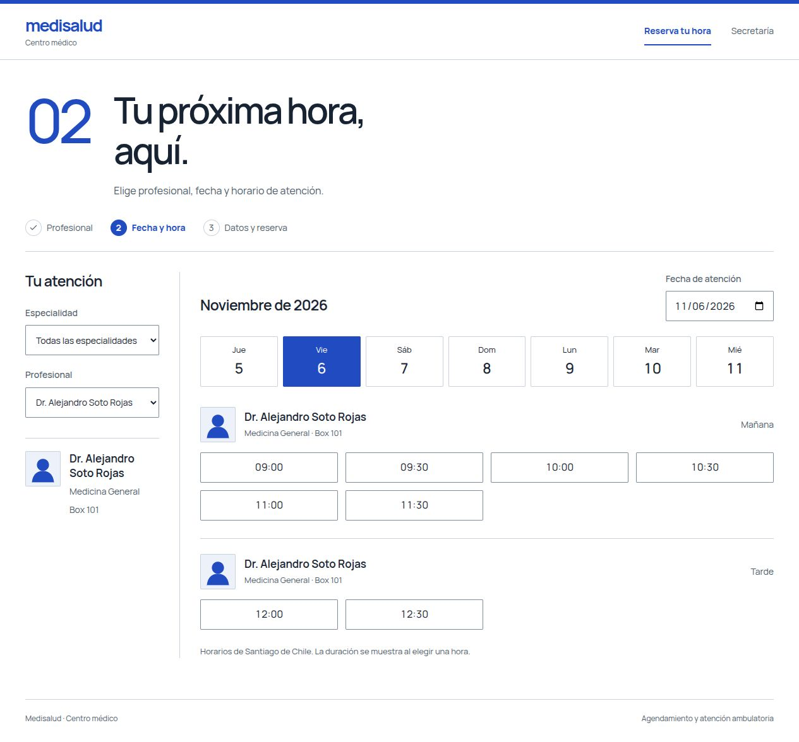
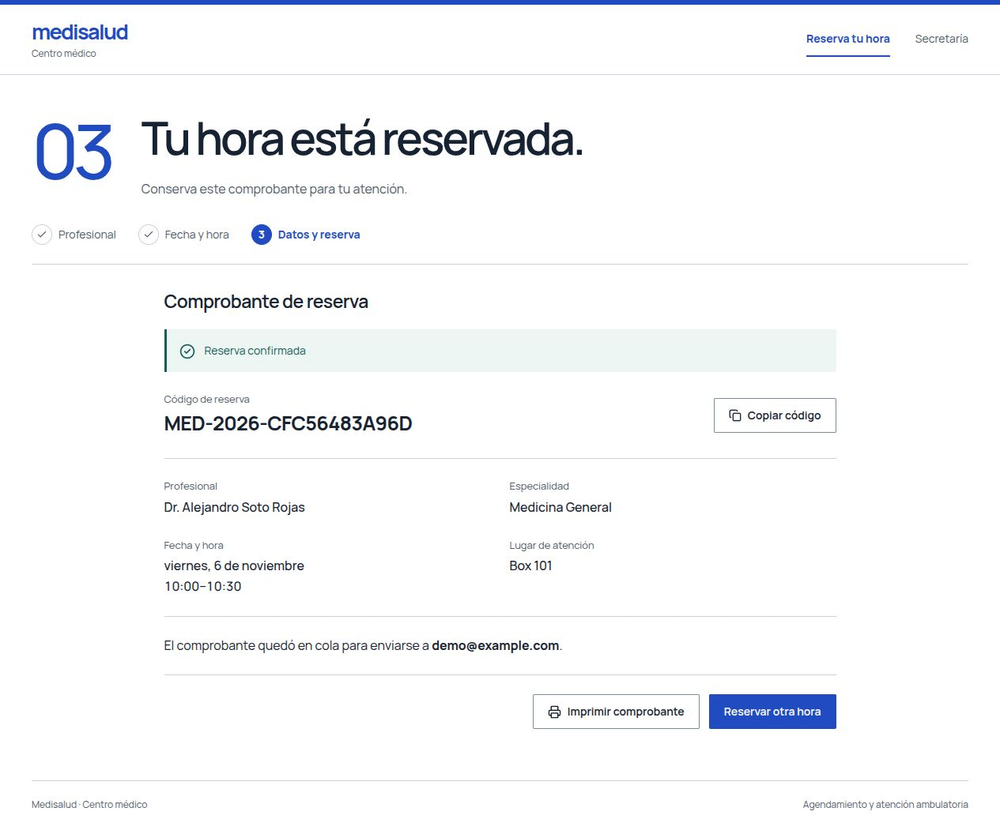
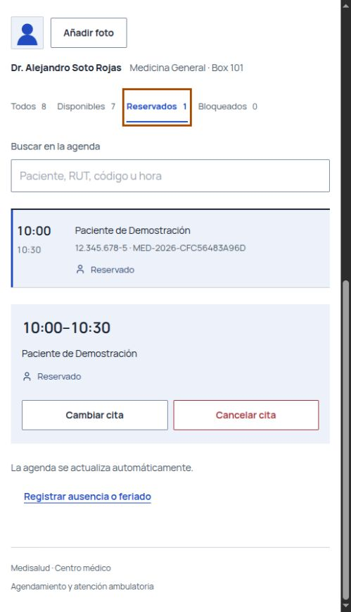

# Medisalud — Gestión de citas médicas

Aplicación web académica que reúne la reserva de horas médicas y la gestión de agendas en dos portales: pacientes y secretaría. Desarrollada con React, Node.js/Express y PostgreSQL, permite explorar disponibilidad, reservar citas y administrar cambios de horario desde una misma interfaz.

> **Rama `develop`: versión funcional en desarrollo.** Es la versión recomendada para explorar el avance actual del proyecto; todavía no es una entrega final ni una instalación clínica en producción. Usa únicamente datos ficticios.

## Estado de las ramas

| Rama | Alcance |
| --- | --- |
| [`develop`](https://github.com/MartinIVC/medisalud/tree/develop) | Desarrollo actual: portales de paciente y secretaría, gestión de citas y médicos, fotos y notificaciones en cola. |
| [`main`](https://github.com/MartinIVC/medisalud/tree/main) | Implementación inicial del núcleo de agendamiento. No incluye las ampliaciones actuales de esta rama. |

## Vista previa

Capturas de la versión funcional en desarrollo, tomadas el 5 de noviembre de 2026 en un entorno local aislado con datos ficticios. Muestran la consulta de horarios, una reserva completada y su gestión desde secretaría. El envío real de notificaciones no está habilitado en esta demo.

### 1. Elegir profesional y horario

El portal del paciente permite consultar la disponibilidad por profesional y fecha antes de iniciar la reserva.



### 2. Obtener el comprobante

Al confirmar la reserva, se muestra el código y el detalle de la atención. El aviso por correo queda en cola; la captura no representa una entrega de email confirmada.



### 3. Gestionar la cita desde secretaría

La misma reserva aparece en la agenda, con acciones para cambiarla o cancelarla. Esta captura muestra el panel en una pantalla estrecha, con el filtro de citas reservadas activo.



## Funcionalidades disponibles

### Portal de pacientes

- Consulta de disponibilidad por especialidad, profesional y fecha.
- Reserva con validación de RUT chileno y comprobante con código de reserva.
- Catálogo de profesionales con fotografías e imagen alternativa.
- Confirmación de asistencia o cancelación mediante un enlace con token.

### Panel de secretaría

- Acceso individual para secretaría, con sesiones revocables de ocho horas.
- Configuración de agendas en bloques de 15, 20 o 30 minutos y bloqueo de horarios.
- Registro de citas presenciales o telefónicas.
- Cancelación y reprogramación de citas futuras con motivo, actualización de cupos y avisos en cola.
- Registro de médicos con validación de RUT y prevención de duplicados.
- Carga y reemplazo de fotografías PNG/JPEG, persistidas en PostgreSQL.

### Reservas y notificaciones

- Transacciones con aislamiento `SERIALIZABLE`, bloqueos y reintentos para gestionar reservas concurrentes.
- Idempotencia para evitar duplicar una reserva al repetir una solicitud con la misma clave.
- Cola persistente y worker para confirmaciones, avisos y recordatorios por email y WhatsApp.
- Integraciones con SendGrid/SMTP y Twilio, que requieren configuración externa para enviar mensajes reales.

Una notificación encolada o aceptada por un proveedor **no equivale a una entrega confirmada**. El calendario de secretaría se actualiza por consultas periódicas cada dos segundos.

## En desarrollo y limitaciones

- Auditoría general de acciones por cuenta: pendiente de implementación (MED-27). MED-24 registra la última desvinculación con responsable, fecha y motivo; secretaría puede filtrar profesionales por especialidad y revincularlos sin perder agendas ni citas.
- Validación de entrega real de notificaciones, callbacks de entrega y configuración de dominio SPF/DKIM/DMARC: pendientes.
- La existencia de pruebas automatizadas no implica que todas las historias hayan completado su aceptación funcional.
- Los 15 médicos iniciales son datos semilla de demostración, no un límite del sistema.
- El proyecto no está conectado a una clínica real. Los tiempos de respuesta se evalúan en pruebas; no son una garantía de rendimiento en producción.

## Tecnologías y estructura

| Capa | Tecnologías |
| --- | --- |
| Interfaz | React 18, Vite 6, Tailwind CSS 3 |
| API | Node.js, Express 4 |
| Persistencia | PostgreSQL 16 |
| Notificaciones | Nodemailer, SendGrid/SMTP y Twilio |
| Desarrollo y pruebas | Docker Compose v2, Node.js Test Runner, Testing Library, ESLint y Prettier |

- [`frontend/src/features/`](frontend/src/features/): flujos de pacientes, secretaría y respuesta a citas.
- [`backend/src/services/`](backend/src/services/): lógica de agendas, reservas y gestión de citas.
- [`backend/src/notifications/`](backend/src/notifications/): cola y despacho de notificaciones.
- [`database/`](database/): esquema, datos de demostración y migraciones.
- [Contrato de la API](API_CONTRACT.md), [manual de secretaría](docs/manual-secretaria.md) y [protocolo de marcha blanca simulada](docs/protocolo-marcha-blanca.md).

## Obtener esta versión

```bash
git clone --branch develop --single-branch https://github.com/MartinIVC/medisalud.git medisalud-develop
cd medisalud-develop
```

Los comandos siguientes se ejecutan desde esa carpeta. Si ya utilizas `main`, detén sus contenedores antes de iniciar esta versión: ambas ramas usan los mismos nombres de contenedor y puertos. Para conservar una base anterior, revisa la sección de migraciones antes de reutilizarla.

## Requisitos

Para levantar Medisalud en tu propio equipo, necesitas Docker instalado y en ejecución, junto con Docker Compose v2. Así no hace falta instalar Node.js ni PostgreSQL localmente. Si accedes a una instancia de demostración ya desplegada, basta con abrir su URL.

- **Windows 10/11:** Docker Desktop instalado y activo, con WSL 2 habilitado.
- **Linux:** Docker Engine y el complemento Docker Compose v2; el usuario debe tener permiso para acceder al daemon.
- **macOS:** Docker Desktop instalado y activo.
- Conexión a internet para descargar imágenes y dependencias durante la primera compilación.

Comprueba que Docker y Compose estén disponibles:

```bash
docker --version
docker compose version
docker info
```

En Linux, si recibes `permission denied` al acceder a `/var/run/docker.sock`, vuelve a ejecutar los comandos de Docker con `sudo` o solicita al administrador permisos para usar Docker. En Windows y macOS, inicia Docker Desktop antes de ejecutar Compose.

## Configurar el entorno

Docker Compose puede iniciar el proyecto sin un archivo de configuración: usa valores locales predeterminados para PostgreSQL y la URL del frontend. Para personalizar el entorno, crea un archivo `.env` en la raíz a partir de [`.env.example`](.env.example). Si ya tienes un `.env`, consérvalo y agrega a mano las variables que necesites.

En Linux o macOS, si todavía no existe `.env`:

```bash
cp -n .env.example .env
```

En PowerShell:

```powershell
if (-not (Test-Path .env)) { Copy-Item .env.example .env }
```

El archivo `.env` está excluido de Git: guarda allí tus credenciales y no lo compartas ni lo subas al repositorio. La contraseña de PostgreSQL del ejemplo es solo para la demostración local. En un volumen de PostgreSQL ya creado, cambiar estas variables no actualiza por sí solo el usuario, la contraseña ni la base existentes.

No se crean cuentas de secretaría ni contraseñas por defecto. Después de iniciar los servicios, una persona administradora debe crear la primera cuenta como se indica más abajo. Las variables antiguas `SECRETARY_PASSWORD` y `SECRETARY_TOKEN_SECRET` ya no habilitan el acceso.

Las credenciales de SendGrid o SMTP (email) y Twilio (WhatsApp) son opcionales para ejecutar la aplicación. Sin ellas, el sistema no podrá enviar notificaciones reales. Para usar Gmail en una demostración, descomenta las variables `SMTP_*` del `.env`, completa `SMTP_USER` y `SMTP_FROM` con tu dirección y usa una [contraseña de aplicación de Google](https://support.google.com/mail/answer/185833?hl=es) en `SMTP_PASS`. La plantilla usa `smtp.gmail.com` con el puerto 587 y `SMTP_SECURE=false` para iniciar la conexión mediante STARTTLS. Si también configuras SendGrid, el sistema lo usará con prioridad sobre SMTP.

Después de editar la configuración de correo, recrea el backend para que tome los nuevos valores:

```bash
docker compose up -d --force-recreate backend
```

Para despliegues públicos, configura `PUBLIC_WEB_URL` con la dirección HTTPS del frontend.

## Ejecutar en Windows

1. Instala y abre Docker Desktop. Si te pide habilitar WSL 2, sigue sus instrucciones y reinicia el equipo.
2. Abre PowerShell en la raíz del proyecto. Desde el Explorador puedes abrir la carpeta, escribir `powershell` en la barra de dirección y pulsar Enter.
3. Comprueba Docker:

```powershell
docker --version
docker compose version
docker info
```

4. Configura el archivo .env siguiendo la sección anterior.
5. Construye e inicia PostgreSQL, backend y frontend:

```powershell
docker compose up -d --build
```

6. Revisa el estado de los servicios y los registros del backend:

```powershell
docker compose ps
docker compose logs -f backend
```

7. Si el volumen de PostgreSQL ya existía, aplica las migraciones pendientes de la sección siguiente. Después crea la primera cuenta desde una terminal interactiva:

```powershell
docker compose exec backend node src/cli/secretarias.js crear secretaria.demo
```

El comando solicita la contraseña sin mostrarla. Usa al menos 12 bytes y no la incluyas en el comando ni en Git.

8. Abre el portal en [http://localhost:5173](http://localhost:5173) y comprueba la API en [http://localhost:4000/api/health](http://localhost:4000/api/health).

El paciente puede consultar y reservar sin iniciar sesión. El panel de secretaría solicita el usuario individual y su contraseña; la sesión vence en ocho horas.

Para detener los contenedores conservando la base de datos:

```powershell
docker compose down
```

`docker compose down -v` también elimina el volumen y todos los datos locales. Úsalo solo cuando quieras reiniciar la base desde cero.

## Ejecutar en Linux o macOS

Desde la raíz del proyecto, configura .env y ejecuta:

```bash
docker compose up -d --build
docker compose ps
```

Si tu usuario de Linux no tiene acceso al daemon, antepón `sudo` a esos comandos; por ejemplo, `sudo docker compose up -d --build`.

Si el volumen ya existía, aplica las migraciones pendientes de la sección siguiente. Para crear la primera cuenta, ejecuta en una terminal interactiva `docker compose exec backend node src/cli/secretarias.js crear secretaria.demo` y escribe la contraseña cuando se solicite.

Usa las mismas direcciones locales indicadas arriba. Para detener los servicios sin borrar la base, ejecuta `docker compose down`.

## Administración de cuentas de secretaría

El acceso a la terminal del contenedor es administrativo; no existe autorregistro desde el portal. Para crear otra cuenta, desactivarla, reactivarla o restablecer su contraseña:

```bash
docker compose exec backend node src/cli/secretarias.js crear secretaria.demo
docker compose exec backend node src/cli/secretarias.js desactivar secretaria.demo
docker compose exec backend node src/cli/secretarias.js activar secretaria.demo
docker compose exec backend node src/cli/secretarias.js restablecer secretaria.demo
```

El usuario admite entre 3 y 64 letras ASCII, números, puntos, guiones y guiones bajos; se normaliza a minúsculas. La contraseña debe tener entre 12 y 256 bytes y se ingresa en el prompt, no como argumento. Desactivar, reactivar o restablecer una cuenta revoca sus sesiones; una cuenta desactivada no puede iniciar sesión. Ante una pérdida de acceso, una persona con acceso administrativo restablece la contraseña con el mismo comando. Si fallan intentos repetidos, espera 15 minutos o pide un restablecimiento administrativo.

## Base de datos y migraciones

En una base nueva, Docker ejecuta los scripts SQL iniciales al crear el volumen por primera vez. No vuelve a ejecutar esos scripts sobre un volumen existente.

Para una base previa, haz un respaldo y corrige cualquier horario superpuesto antes de aplicar la migración del Sprint 2. En PowerShell:

```powershell
Get-Content -Raw .\database\migrations\20261028_sprint2.sql |
  docker compose exec -T db psql -U medisalud -d medisalud_db
```

En Linux/macOS:

```bash
docker compose exec -T db psql -U medisalud -d medisalud_db < database/migrations/20261028_sprint2.sql
```

Si cambiaste POSTGRES_USER o POSTGRES_DB en .env, reemplaza los valores del comando. No ejecutes la migración contra producción sin revisar y respaldar la base.

La migración de RUT normalizado protege también las instalaciones con volumen existente. Antes de aplicarla, revisa y respalda la base. Si detecta dos registros que representan el mismo RUT, se detiene e informa los IDs para resolver la colisión manualmente; no modifica esos registros. En PowerShell:

```powershell
Get-Content -Raw .\database\migrations\20261028_medicos_rut_normalizado.sql |
  docker compose exec -T db psql -U medisalud -d medisalud_db
```

En Linux/macOS:

```bash
docker compose exec -T db psql -U medisalud -d medisalud_db < database/migrations/20261028_medicos_rut_normalizado.sql
```

Para instalaciones que aún no tienen las columnas de toma de notificaciones o la respuesta de idempotencia, aplica después las migraciones `20261028_notifications_leases.sql` y `20261028_idempotency_response.sql`, en ese orden. La base nueva ya incluye esos campos en `database/01_init.sql`.

PowerShell:

```powershell
Get-Content -Raw .\database\migrations\20261028_notifications_leases.sql |
  docker compose exec -T db psql -U medisalud -d medisalud_db
Get-Content -Raw .\database\migrations\20261028_idempotency_response.sql |
  docker compose exec -T db psql -U medisalud -d medisalud_db
```

Linux/macOS:

```bash
docker compose exec -T db psql -U medisalud -d medisalud_db < database/migrations/20261028_notifications_leases.sql
docker compose exec -T db psql -U medisalud -d medisalud_db < database/migrations/20261028_idempotency_response.sql
```

Para habilitar la gestión de cancelaciones y cambios de cita en una base existente, aplica también la migración que permite varios avisos de cambio por reserva:

```powershell
Get-Content -Raw .\database\migrations\20261030_gestion_reservas.sql |
  docker compose exec -T db psql -U medisalud -d medisalud_db
```

```bash
docker compose exec -T db psql -U medisalud -d medisalud_db < database/migrations/20261030_gestion_reservas.sql
```

Después de las migraciones anteriores, para habilitar las fotos de profesionales en una base existente aplica una sola vez `20261103_medicos_foto.sql`, tras revisar la migración y respaldar la base:

```bash
docker compose exec -T db psql -U medisalud -d medisalud_db < database/migrations/20261103_medicos_foto.sql
```

En PowerShell, usa:

```powershell
Get-Content -Raw .\database\migrations\20261103_medicos_foto.sql |
  docker compose exec -T db psql -U medisalud -d medisalud_db
```

Las fotos se guardan en PostgreSQL y persisten en el volumen existente `medisalud_pgdata`; no se necesita un volumen de archivos ni almacenamiento externo. En una base nueva, `01_init.sql` ya incluye las columnas.

Para pasar una base existente a cuentas individuales, respáldala y aplica `20261107_cuentas_secretaria.sql` después de las migraciones anteriores:

```bash
docker compose exec -T db psql -U medisalud -d medisalud_db -v ON_ERROR_STOP=1 < database/migrations/20261107_cuentas_secretaria.sql
```

En PowerShell:

```powershell
Get-Content -Raw .\database\migrations\20261107_cuentas_secretaria.sql |
  docker compose exec -T db psql -U medisalud -d medisalud_db -v ON_ERROR_STOP=1
```

Sustituye el usuario y la base si cambiaste las variables de PostgreSQL. Para evitar una interrupción en una base existente: aplica la migración con el backend anterior aún operativo, construye la nueva imagen con `docker compose build backend`, crea una cuenta con `docker compose run --rm --no-deps backend node src/cli/secretarias.js crear secretaria.demo` y luego actualiza el servicio con `docker compose up -d --no-deps backend`. Las sesiones anteriores dejan de ser válidas al desplegar la nueva versión y cada secretaria debe usar su cuenta individual. La migración no convierte la contraseña compartida en cuentas personales. En una base nueva, `01_init.sql` ya incluye las tablas.

Para habilitar la desvinculación en una base existente, respáldala y aplica `20261107_desvinculaciones_medico.sql` después de la migración de cuentas:

```bash
docker compose exec -T db psql -U medisalud -d medisalud_db < database/migrations/20261107_desvinculaciones_medico.sql
```

En PowerShell, usa `Get-Content -Raw .\database\migrations\20261107_desvinculaciones_medico.sql | docker compose exec -T db psql -U medisalud -d medisalud_db`. Una base nueva ya incluye la tabla. Los profesionales inactivos anteriores no tienen fecha, motivo ni responsable retroactivos.

## Verificación automatizada

Para ejecutar las comprobaciones de calidad localmente necesitas Node.js 22.22.2 o posterior, mientras sea menor que la versión 27. Esta versión mínima mantiene las pruebas de frontend compatibles con las dependencias fijadas en `frontend/package-lock.json`. Instala dependencias desde los tres lockfiles y ejecuta el conjunto habitual:

```bash
npm ci
npm ci --prefix backend
npm ci --prefix frontend
npm run check
```

`npm run check` ejecuta ESLint, verifica el formato con Prettier, corre las pruebas unitarias de backend y frontend, revisa la sintaxis del arranque del backend y crea el build de Vite con Tailwind incluido. El navegador ya no descarga estilos desde un CDN.

Las pruebas de aceptación Sprint 1 y Sprint 3 modifican datos y solo aceptan una base local cuyo nombre termina en `_test`, declarada explícitamente mediante `TEST_DATABASE_URL` y `TEST_API_URL`. Usa el Compose aislado, que mantiene PostgreSQL en memoria y no lee ni modifica la base normal del proyecto:

```bash
docker compose -f docker-compose.test.yml down -v
docker compose -f docker-compose.test.yml up -d --build
docker compose -f docker-compose.test.yml exec -T backend-test npm run test:sprint1
docker compose -f docker-compose.test.yml exec -T backend-test npm run test:sprint3
docker compose -f docker-compose.test.yml exec -T backend-test npm run test:gestion-reservas
docker compose -f docker-compose.test.yml exec -T backend-test npm run test:fotos-medicos
docker compose -f docker-compose.test.yml exec -T backend-test npm run test:secretarias
docker compose -f docker-compose.test.yml down -v
```

Para repetir la aceptación desde una base vacía, ejecuta `down -v` antes de volver a `up`. El servicio de prueba no tiene credenciales de proveedores: valida la cola local, pero no entrega correos ni mensajes reales. CI ejecuta las mismas suites sobre PostgreSQL 16 descartable.

La prueba de aceptación Sprint 1 lanza 40 consultas de disponibilidad y 40 reservas sobre el mismo bloque en una carga mixta. Verifica el p95 observado por el cliente para ambos endpoints (<= 2,0 s), una única cita confirmada y 39 rechazos; también comprueba reservas simultáneas en bloques distintos. La reserva usa `SERIALIZABLE`, permite hasta cinco intentos totales ante abortos de serialización y limita cada espera de bloqueo a 1,5 s.

La prueba de gestión de citas usa la base descartable y verifica acceso de secretaría, validaciones, rechazo de un cupo bloqueado, cambio de horario, cancelación y actualización de avisos y recordatorios. Limpia las citas y agendas que crea al terminar.

El contrato de errores HTTP y la representación aceptada para RUT están descritos en [API_CONTRACT.md](API_CONTRACT.md).
